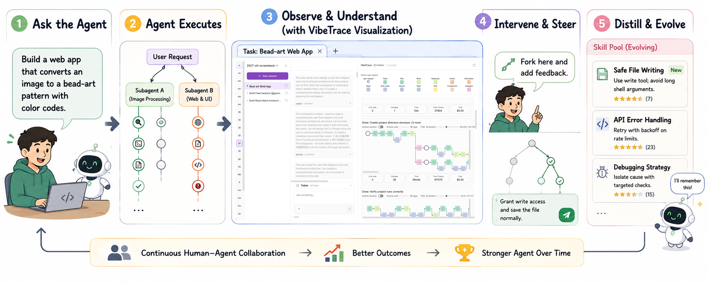
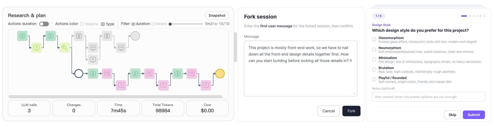
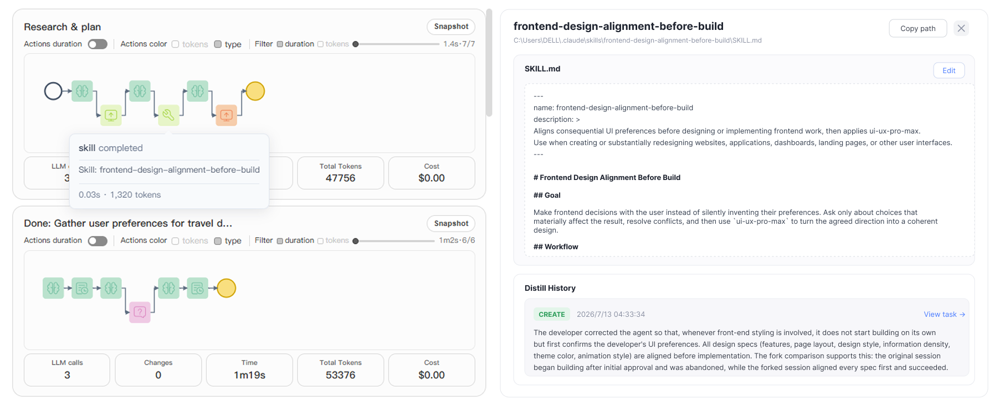

<h1 align="center">VibeTrace</h1>

<p align="center"><strong>See how your agents think. Steer what happens next.</strong></p>

<p align="center">
  A visual workspace for human–agent collaboration with <a href="https://opencode.ai/">OpenCode</a>.<br />
  Understand execution, intervene at any action, and turn experience into reusable skills.
</p>

<p align="center">
  <a href="#installation">Installation</a> ·
  <a href="#1-layered-real-time-execution-visualization">Visualization</a> ·
  <a href="#2-action-level-process-intervention">Intervention</a> ·
  <a href="#3-continuous-skill-evolution">Skill evolution</a>
</p>

<p align="center">
  
</p>

## Three core capabilities

### 1. Layered real-time execution visualization

VibeTrace turns raw OpenCode message streams into a structured, reviewable execution surface:

- **Task-aware session view** — Detects when the user switches tasks inside a session and surfaces each completed task as its own tab, so trajectories from different goals are not mixed together.
- **Subtask panels from todos** — Within a task, planner todos are materialized into subtask panels. Each panel shows the action-flow trace for that slice of work, making it easy to locate and audit specific steps.
- **Rich action-flow rendering** — Orthogonal layout of mapped tool/agent steps, branching forks, contextual tooltips, and click-to-focus linking between the flow, todos, and transcripts. **`Actions duration`** toggles between fixed step spacing and horizontally scaled blocks keyed to measured duration. **`Actions color`** switches the palette between **tokens** and **tool type** lenses. Toolbar **`timeline` / `summary`** changes how subtasks are arranged in the rail; fullscreen is available for the flow view.
- **Per-panel analysis** — Each subtask panel can show a trace summary and automated error diagnosis to help you understand what happened and where things went wrong.
- **Cross-linking** — Optional connectors from todo rows into a linked card **or into the focused action** when one is selected.

<p align="center">
  
</p>

### 2. Action-level process intervention

Beyond observation, VibeTrace supports interactive steering grounded in the live trajectory:

- **Fork from any action** — Branch the session at a specific tool/agent step, capture a pre-fork panel snapshot, and continue in a new OpenCode session while preserving comparison context.
- **Trajectory-based branching** — Fork connectors and ghost trails show how a branched run diverges from the parent path, so you can experiment without losing sight of the original execution.


<p align="center">
  
</p>

### 3. Continuous skill evolution

VibeTrace turns execution traces and feedback into reusable skills:

- **Learn from completed tasks** — Task-switch detection separates completed work from the next goal, providing task-level evidence for skill evolution.
- **Distill and refine skills** — The evolution pipeline evaluates trace evidence, distills candidate changes, scores them, and writes accepted changes to local skill files. Skills can be created, revised, merged, or removed as experience accumulates.
- **Learn from feedback** — Task-level and panel-level feedback can be distilled into reusable guidance, with links back to the source trajectory for review.

<p align="center">
  
</p>

Analysis is triggered through the dashboard and uses models configured in OpenCode. Background model availability and quota affect whether analysis and evolution can complete; installing the plugin does not by itself train or change the underlying model.

---

## Installation

Requires OpenCode, Node.js 20+, and Python 3.9+.
The commands below work on macOS, Windows, and Linux.

First, check your OpenCode version:

```sh
opencode --version
```

### OpenCode V1 (`1.x`)

```sh
npx --yes @xiaokeyan/opencode-vibetrace@1.0.2 setup
```

### OpenCode V2 (`2.x`)

```sh
npx --yes @xiaokeyan/opencode-v2-vibetrace@1.0.1 setup
```

Then restart OpenCode (fully quit and reopen Desktop) and open your project as usual.
For V2, run `opencode service restart` before reopening OpenCode.
VibeTrace opens its dashboard automatically.

### Uninstall

**OpenCode V1:**

```sh
npx --yes @xiaokeyan/opencode-vibetrace@1.0.2 uninstall
```

**OpenCode V2:**

```sh
opencode plugin remove @xiaokeyan/opencode-v2-vibetrace@1.0.1
```

Restart OpenCode afterwards. For V2, also run `opencode service restart`.
Your chat history and VibeTrace data are preserved.

---

## Tech stack

React 19 · TypeScript · Vite · Tailwind CSS 4 · d3 · react-tooltip

---

## License

[MIT](./LICENSE)
